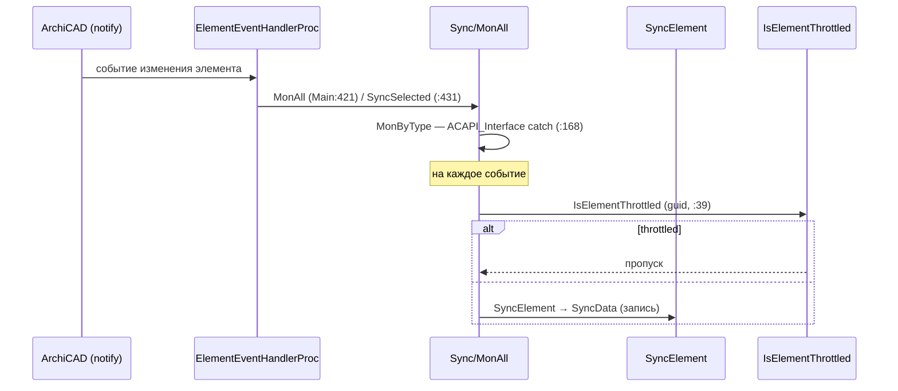
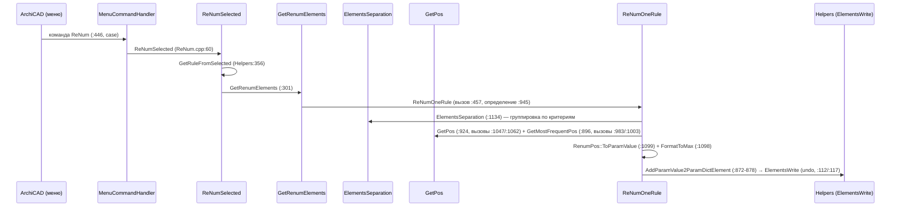
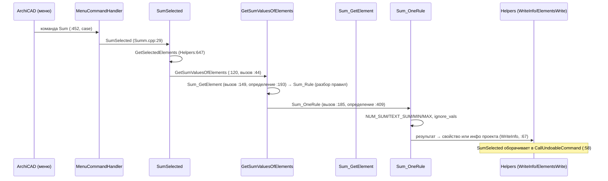
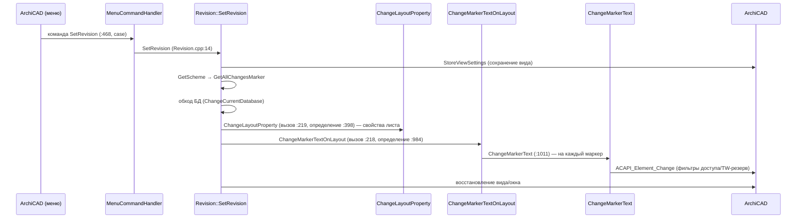
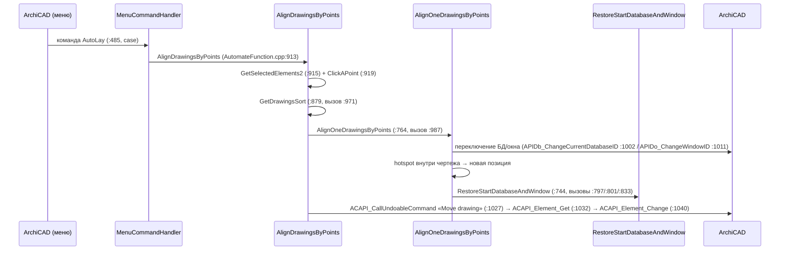
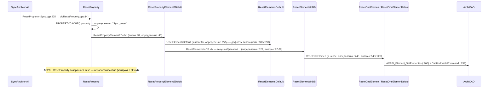
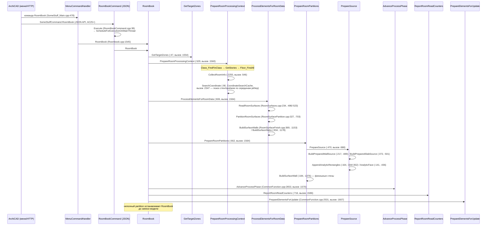

# SEQUENCES — Ключевые сценарии

> Хеш коммита: после `68efad7` (2026-10-15, ветвь `roombook_refactor`). Набор из 11 сценариев (10 согласованы 2026-09-22 после `12874ab`; сценарий 11 добавлен 2026-10-15). Координаты сверены с исходником 2026-10-15 (коммиты `18d05b7..68efad7` сместили строки в `SomeStuff_Main.cpp`, `Sync.cpp`, `spec/`, `ReNum.cpp`, `Helpers.cpp`, `Dimensions.cpp`, `pk/`, `dialogs/BrowserPalette.cpp`). Все сообщения — из `Docs/_generated/callgraph.json` и `body_scan.json` (координаты в тексте — 1-based).

## 1. Полная синхронизация

```mermaid
sequenceDiagram
    participant UI as ArchiCAD (меню)
    participant Main as MenuCommandHandler
    participant SS as SyncSettings
    participant PC as PROPERTYCACHE
    participant Sync as SyncAndMonAll
    participant RP as ResetProperty (pk)
    participant SBT as SyncByType
    participant SE as SyncElement
    participant SD as SyncData
    participant H as Helpers (ElementsWrite)

    UI->>Main: команда Sync All (SomeStuff_Main.cpp:426, case :423)
    Main->>SS: LoadSyncSettingsFromPreferences (:401)
    Main->>PC: Update (:410)
    Main->>Sync: SyncAndMonAll (:426)
    Sync->>RP: ResetProperty (:225)
    RP-->>Sync: true → ранний выход (сброс выполнен)
    Sync->>SBT: SyncByType ×6 (wallS/widoS/objS/cwallS/dim/ext, :242-283)
    SBT->>SBT: ACAPI_Element_GetElemList (:347)
    SBT->>SE: SyncElement (:374; определение :404/:412)
    SE->>SD: SyncData (:432/:446; определение :753)
    SD->>SD: ParseSyncString (:809, определение :1178) → SyncCalcRule (:835/:840, определение :894)
    SD->>H: ElementsWrite (запись свойств)
    Note over H: запись в undoable-области
```

## 2. Мониторинг изменений элементов



## 3. Спецификация

```mermaid
sequenceDiagram
    participant UI as ArchiCAD (меню)
    participant Main as MenuCommandHandler
    participant SA as SpecAll
    participant F as SpecFilter
    participant SAR as SpecArray
    participant GER as GetElementsForRule
    participant PE as PlaceElements
    participant GEP as GetElementForPlace

    UI->>Main: команда Spec (:462, case :460)
    Main->>SA: SpecAll (Spec.cpp:155)
    SA->>SA: GetSelectedElements (:192) / GetRuleFromDefaultElem (:40, вызов :204)
    SA->>F: SpecFilter (:196/:215, определение :251) — типы/БД
    SA->>SAR: SpecArray (:229; определение :633)
    Note over SA: отказ «все флаги выключены» идёт<br/>в накопитель результата, окно одно<br/>(ShowRunResult :226), не всплывает
    SAR->>GER: GetElementsForRule (:2086) — группировка, параметры
    SAR->>GER: PlanRuleRows (:1839)
    SAR->>PE: PlaceElements (SpecExecutor.cpp:12)
    PE->>GEP: GetElementForPlace (Spec.cpp:3085)
    PE->>PE: ACAPI_Element_Create (:162) — БЕЗ CallUndoableCommand<br/>(APIERR_NOTMINE, комментарий :275)
    PE->>PE: UnhideUnlockElementLayer (:90)
    PE->>PE: WriteSpecProperties (:281)
    Note over PE: вклад источника — BuildContribution<br/>(SpecPlanning.cpp:20)
```

## 4. Перенумерация



## 5. Суммирование



## 6. Округление размеров

```mermaid
sequenceDiagram
    participant EV as Обработчики (Menu/Element/Project)
    participant DRA as DimRoundAll
    participant DRB as DimRoundByType
    participant DAR as DimAutoRound
    participant DP as DimParse
    participant AC as ArchiCAD (Element_Change)

    EV->>DRA: DimRoundAll (Dimensions.cpp:429; вызовы в Main:142/509)
    DRA->>DRA: ACAPI_CallUndoableCommand (:436)
    DRA->>DRB: DimRoundByType (:437/:441; определение :451)
    DRB->>DAR: DimAutoRound (:36)
    DAR->>DAR: preadelem — предчтение параметров привязанного элемента
    DAR->>DP: DimParse (:190, определение :291)
    DP->>DP: правила из PROPERTYCACHE (DimReadPref), формулы
    DP-->>DAR: custom_txt + flag_change/highlight
    DAR->>AC: ACAPI_Element_Change (:275)
```

## 7. Браузерная палитра

```mermaid
sequenceDiagram
    participant UI as ArchiCAD (меню/выделение)
    participant Main as MenuCommandHandler
    participant BP as BrowserPalette
    participant HTML as HTML (DG::Browser)
    participant SCH as SelectionChangeHandler

    UI->>Main: команда палитры (:489, case Pallete_CommandID)
    Main->>BP: ShowOrHideBrowserPalette (BrowserPalette.cpp:45)
    BP->>HTML: Show → загрузка Interface_ru.html
    BP->>HTML: UpdateSelectionInfoInUI — executeJS (:340, вызов :328)
    UI->>SCH: смена выделения
    Note over SCH: SelectionChangeHandlerProc (SomeStuff_Main.cpp:355)<br/>→ BrowserPalette::SelectionChangeHandler
    SCH->>SCH: suppressSelectionRefresh? (BrowserPalette.cpp:40/:869,<br/>SuppressSelectionRefreshGuard) — при программной подсветке выход
    SCH->>BP: ManualGetSelection (:1977) → UpdateSelectionInfoInUI
    HTML->>BP: JS-мост (RegisterACAPIJavaScriptObject; аргументы DynamicCast<JSValue>)
```

## 8. Ревизии



## 9. Выравнивание чертежей



## 10. Сброс свойств



## 11. Спецификация отделки (RoomBook)


