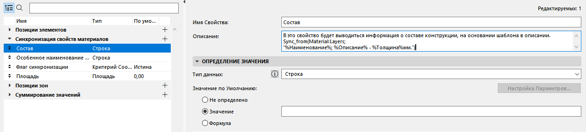
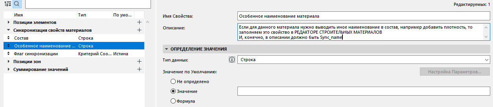
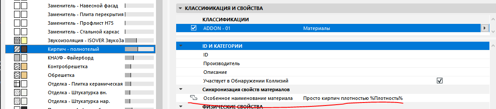

## Вывод состава конструкций в свойства

[Видео на YouTube с примером](https://www.youtube.com/watch?v=4k18thw7Gso)

[Файл с примером для АС25](https://github.com/kuvbur/AddOn_SomeStuff/blob/master/wiki/files/%D0%A1%D0%BE%D1%81%D1%82%D0%B0%D0%B2%20%D0%BA%D0%BE%D0%BD%D1%81%D1%82%D1%80%D1%83%D0%BA%D1%86%D0%B8%D0%B8%20%D1%81%20%D0%BE%D0%B1%D1%8A%D1%91%D0%BC%D0%B0%D0%BC%D0%B8_25.pln)

## Общие сведения

Аддон может записать состав конструкции в свойство элемента: например, перечислить материалы и толщины слоёв или вывести их количество. Правило записывается в **описание свойства, в которое нужен результат**. Имя этого свойства может быть произвольным.

Для текстового состава используйте правило:

`Sync_from{Material:Layers; "СТРОКА_ШАБЛОН"}`

Шаблон описывает **один слой**. Аддон подставляет в него значения для каждого слоя и соединяет полученные строки. Обычный текст остаётся без изменений, а имена свойств и специальные обозначения нужно заключать в знаки `%`.

Например:

`Sync_from{Material:Layers; "%Описание% - %Толщина.2mm%мм. "}`

Здесь `%Описание%` — описание строительного материала, `%Толщина.2mm%` — толщина слоя с заданным числовым форматом, а `мм.` — обычный текст. Пробел в конце отделяет один слой от следующего. Подробнее о числовых форматах — в разделе [округления толщин и свойств](https://github.com/kuvbur/AddOn_SomeStuff/wiki/Rounding-Thicknesses-Properties-ru).

Толщину можно обозначить как `%Толщина%`, `%layer_thickness%` или `%th%` (_v1.77+_).

Для многослойной конструкции `Layers` берёт слои в порядке редактора: первым идёт верхний слой списка. В сложном профиле порядок задаётся линией сечения и окружностью со стороны первого слоя — подробнее ниже.

Чтобы развернуть порядок, используйте:

`Sync_from{Material:Layers_inv; "СТРОКА_ШАБЛОН"}`

Вариант `Layers_auto` разворачивает порядок для непрофильных стен; для остальных конструкций сохраняет обычный порядок. Он предназначен для вывода состава в порядке предпросмотра поперечного 2D-сечения:

`Sync_from{Material:Layers_auto; "СТРОКА_ШАБЛОН"}`

`%n%` — номер слоя в выбранном порядке. Если часть слоёв скрыта спецтекстом, в этой нумерации будут пропуски. `%ns%` (_v1.77+_) нумерует только непустые строки, поэтому подходит для перечня без пропусков. Само по себе `%ns%` слои не скрывает.

В шаблоне можно обращаться к встроенным и пользовательским свойствам. По умолчанию пользовательское свойство читается у **элемента**, а не у строительного материала. Чтобы читать его у материала, добавьте в **описание этого пользовательского свойства** маркер `{@property:buildingmaterialproperties}` (_v1.72+_). Не путайте его с правилом `Sync_from`, которое находится в описании свойства-результата.

Для обращения к данным из информации о проекте используйте явный источник в фигурных скобках: `{Info:ИМЯ_ПОЛЯ}`. В отличие от обозначений свойств материала, эту запись не нужно заключать в `%`.

## Состав стен, колонн и балок со сложным профилем

В редакторе профиля проведите линию через нужные слои. Рядом с первым слоем разместите окружность. У линии и окружности должно быть одно и то же перо; его номер указывается в правиле:

`Sync_from{Material:Layers,НОМЕР_ПЕРА; "СТРОКА_ШАБЛОН"}`

Например, для пера 20:

`Sync_from{Material:Layers,20; "%n%. %Описание% - %Толщина.2mm%мм. "}`

Аддон определяет толщины по пересечениям линии со штриховками профиля, а порядок слоёв — по расстоянию до центра окружности. Если номер пера в правиле не указан, используется перо 20. Для обратного порядка можно указать `Layers_inv,20`.

## [Округление толщин и остальных численных свойств](https://github.com/kuvbur/AddOn_SomeStuff/wiki/Rounding-Thicknesses-Properties-ru)

## Переносы строк и дополнение текста пробелами

Для интерактивных каталогов вместо переноса строки можно дополнять текст каждого слоя пробелами. Добавьте в конец шаблона `~КОЛ_ВО_ЗНАКОВ `, например `~200 `. Вариант `@КОЛ_ВО_ЗНАКОВ ` использует табуляцию вместо пробелов. После числа **обязательно нужен пробел**; число должно быть от 1 до 999.

`Sync_from{Material:Layers_auto,20; "%Описание% - %Толщина.2mm%мм. ~200 "}`

Если текст слоя короче 200 знаков, он будет дополнен до этой длины. Это не обрезка текста: более длинная строка сохраняется целиком. Подбирайте длину под ширину столбца и шрифт каталога; такое дополнение само по себе не вставляет символ переноса строки.

Для вывода в выноску можно использовать специальные обозначения символов:

- `\TAB` — табуляция, U+0009;
- `\CRLF` — возврат каретки и перевод строки, U+000D U+000A;
- `\CR` — возврат каретки, U+000D;
- `\LF` — перевод строки, U+000A;
- `\PS` — разделитель абзацев, U+2029;
- `\LS` — разделитель строк, U+2028;
- `\NEL` — переход на следующую строку, U+0085;
- `\NL` — видимый знак новой строки, U+2424 (не сам перенос).

Например:

`Sync_from{Material:Layers_auto,20; "%Описание% - %Толщина.2mm%мм. \CRLF"}`

**В текущей реализации для AC29 и AC30 замена обозначений `\TAB`, `\CRLF` и остальных из этого списка отключена**: они останутся обычным текстом. Дополнение через `~число ` и `@число ` этим ограничением не затронуто. Отображение управляющих символов в других версиях также зависит от выноски или каталога, куда выводится свойство.

## Спецтекст для отдельного материала

Спецтекст позволяет заменить общий шаблон для выбранного строительного материала. Создайте текстовое свойство, добавьте в его описание `Sync_name` и сделайте его доступным для класса материала. Затем классифицируйте материал и задайте ему значение этого свойства. Важно задать собственное значение, а не оставить значение по умолчанию: аддон использует именно переопределённый спецтекст.

Например, вместо общей строки с описанием и толщиной можно вывести пояснение для конкретного материала. Если задать один пробел, материал не будет виден в текстовом составе. Это не удаляет его из модели и не меняет его объём.

Чтобы в конкретном правиле не применять спецтекст, добавьте `%nosyncname%` внутрь шаблона:

`Sync_from{Material:Layers; "%nosyncname%%Описание% - %Толщина.2mm%мм. "}`

Сам маркер в результат не выводится. Он отключает спецтекст только для этого правила.

## _v1.72_ Формулы по слоям

Если в шаблоне есть выражение в угловых скобках `<...>`, аддон повторяет эту часть для каждого слоя, подставляет значения и затем вычисляет итоговое выражение. Текст вне угловых скобок не повторяется, но тоже входит в итоговую формулу.

Например, для конструкции из штукатурки 20 мм, кирпича 380 мм и штукатурки 20 мм:

`Sync_from{Material:Layers; "<+2*%Толщина.1mm%>"}`

После подстановки получается выражение `+2*20+2*380+2*20`, его результат — 840. Если нужен ещё один постоянный член, добавьте его вне повторяемой части:

`Sync_from{Material:Layers; "1+<+2*%Толщина.1mm%>"}`

Результат будет 841. Знак `+` в начале повторяемой части соединяет слагаемые разных слоёв. Без него соседние выражения склеятся: `<2*%Толщина.1mm%>` не задаёт сумму по слоям. Для обычного перечисления материалов не используйте угловые скобки — они включают расчёт формулы.

## _v1.76_ Вывод состава выноской [BeArt Label mod](https://github.com/kuvbur/gdl_bibl/tree/master/kuvbur_%D0%92%D1%8B%D0%BD%D0%BE%D1%81%D0%BA%D0%B8%20%D0%B8%20%D1%88%D1%82%D0%B0%D0%BC%D0%BF)

Для этой выноски использовались следующие шаблоны:

`Sync_from{Material:Layers,20; "m[%штриховка%]t[%толщина.2mm%]@"}`

`Sync_from{Material:Layers,20; "b[%bmat_inx%]t[%толщина.2mm%]@"}`

Это примеры для BeArt Label mod, а не универсальный формат для любых выносок. Аддон подставляет значения в строку; чтобы получить нужное отображение, объект выноски должен поддерживать такой формат. Совместимость этих примеров с текущей версией BeArt Label mod не проверена.

## _v1.77+_ Вывод количества компонентов в свойство

Для чтения количеств вместо номера пера укажите `all`. Например:

`Sync_from{Material:Layers,all; "%Описание%: %qty% %unit%; "}`

В этом режиме аддон читает компоненты конструкции и их количества, а не только пересечения с линией в редакторе профиля. Для объединения повторяющихся слоёв с одним строительным материалом и одинаковой толщиной используйте `unic`:

`Sync_from{Material:Layers,unic; "%Описание%: %qty% %unit%; "}`

При объединении суммируются площади, объёмы, длины и количества. `unic` подходит для перечня материалов, но не для послойного описания: исходный порядок слоёв после объединения не сохраняется.

**Объёмы компонентов зависят от пересечений элементов, в том числе от групп пересечения слоёв Archicad.** При проверке результата учитывайте настройки модели.

В шаблоне доступны:

- `%area%` — площадь компонента;
- `%area_section%` — площадь его сечения, например площадь штриховки материала в сложном профиле;
- `%volume%` — объём компонента;
- `%length%` — длина;
- `%width%` — ширина;
- `%qty%` — площадь, объём или длина в зависимости от единицы измерения материала, умноженные на коэффициент запаса;
- `%unit%` — единица измерения из свойства материала;
- `%unit_prefix%` — `S` для площади, `V` для объёма или `L` для длины.

При расчёте используются метры, квадратные и кубические метры, а представление числа задаётся форматом в шаблоне. Например, `%length.2m%` выводит длину в метрах, `%length.0mm%` — в миллиметрах. Без явного формата `%length%` и `%width%` по умолчанию выводятся в миллиметрах. Наличие ключа в шаблоне не гарантирует, что соответствующий размер определяется для любого типа элемента: это зависит от геометрии и доступных данных компонента.

Спецтекст материала может заменить и шаблон с количеством. Если это нежелательно, добавьте `%nosyncname%` в шаблон.

### Свойства строительных материалов для вывода количества

Создайте свойства, доступные для классов строительных материалов, и классифицируйте сами материалы. **Имена свойств могут быть любыми**: аддон распознаёт их по маркерам в **описании**. Значения задаются каждому материалу.

- `some_stuff_units` — единица измерения. Для `кв.м.` или `м²` в `%qty%` попадает площадь, для `куб.м.` или `м³` — объём, для `п.м.` — длина. Значение `не специфицировать` даёт нулевое `%qty%`, но само по себе не скрывает строку материала. Без заданной единицы `%qty%` также равно нулю. Для прямого вывода `%area%`, `%volume%` и `%area_section%` это свойство не требуется.
- `some_stuff_th` — необязательное свойство типа «Длина»: расчётная толщина материала, например гидроизоляции. Используется при расчёте недостающей площади по объёму и толщине; если толщина не задана, аддон использует толщину из конструкции, когда она доступна. Это не изменение геометрии. Не следует считать это свойство универсальной заменой толщины, выводимой через `%Толщина%`: для количеств и обычного послойного описания используются разные пути получения данных.
- `some_stuff_kzap` — необязательный числовой коэффициент запаса. Влияет на `%qty%`, но не увеличивает `%area%`, `%volume%` или `%length%`. Например, запас 10 % задаётся значением `1,1`, а не `10`. Если коэффициент отсутствует, равен нулю или отрицательный, используется 1.

## Вывод свойств материалов

Помимо пользовательских свойств можно выводить встроенные данные строительных материалов. Например, в русской версии Archicad эти шаблоны используют одни и те же данные:

`Sync_from{Material:Layers; "%Описание% - %Толщина.2mm%мм. "}`

`Sync_from{Material:Layers; "%BuildingMaterialProperties/Building Material Description% - %layer_thickness.2mm%мм. "}`

И короткие обозначения, и полные имена заключаются в `%`. Русские названия встроенных свойств зависят от языка Archicad; полные имена удобны, если правило должно работать с разными локализациями.

- `%material class name%` или `%material class name; ИМЯ_КЛАССИФИКАЦИИ%` — имя класса строительного материала (_v1.78+_).
- `%material class id%` или `%material class id; ИМЯ_КЛАССИФИКАЦИИ%` — ID класса строительного материала (_v1.78+_).
- `%material class description%` или `%material class description; ИМЯ_КЛАССИФИКАЦИИ%` — описание класса строительного материала (_v1.78+_).

После точки с запятой указывается имя **системы классификации**, а не имя класса. Без него используется первая классификация материала из прочитанных аддоном.

- `%n%` — номер слоя в выбранном порядке, включая слои со скрытым текстом.
- `%ns%` — последовательный номер непустой строки (_v1.77+_).
- `%layer_thickness%` — то же, что `%Толщина%`.
- `%th%` — то же, что `%Толщина%` (_v1.77+_).
- `%layer_min_thickness%` или `%th_min%` — дополнительное значение минимальной толщины, если оно определено и отличается от основной. В текущем коде оно рассчитывается для 3D-сеток; это не универсальный способ найти минимум толщины любого профиля.
- `%unit%` — единица измерения из свойства с описанием `some_stuff_units` (_v1.77+_).
- `%kzap%` — коэффициент из свойства с описанием `some_stuff_kzap` (_v1.77+_).
- `%area%`, `%area_section%`, `%volume%`, `%length%`, `%width%`, `%qty%`, `%unit_prefix%` — значения для режимов `all` и `unic`, описанные выше.
- `%bmat_inx%` — индекс строительного материала.
- `%cutfill_inx%` — индекс штриховки.
- `%BuildingMaterialProperties/Building Material ID%` — то же, что `%id%`.
- `%BuildingMaterialProperties/Building Material Name%` — `%наименование%`.
- `%BuildingMaterialProperties/Building Material Description%` — `%описание%`.
- `%BuildingMaterialProperties/Building Material Manufacturer%` — `%производитель%`.
- `%BuildingMaterialProperties/Building Material Density%` — `%плотность%`.
- `%BuildingMaterialProperties/Building Material CutFill%` — имя штриховки, то же, что `%штриховка%`.
- `%structype%` — тип слоя (ядро/отделка/другое)

Другие встроенные свойства материалов:

- `%BuildingMaterialProperties/Attribute Name%`
- `%BuildingMaterialProperties/Building Material Embodied Carbon%`
- `%BuildingMaterialProperties/Building Material Embodied Energy%`
- `%BuildingMaterialProperties/Building Material Heat Capacity%`
- `%BuildingMaterialProperties/Building Material Thermal Conductivity%`
- `%BuildingMaterialProperties/Building Material CutFill Foreground Pen%`
- `%BuildingMaterialProperties/Building Material CutFill Background Pen%`
- `%BuildingMaterialProperties/Building Material CutMaterial%`
- `%BuildingMaterialProperties/Building Material Participates in Collision Detection%`
- `%MaterialProperties/Material Vectorial Hatching Fill Index%`
- `%MaterialProperties/Material Vectorial Hatching Pen Index%`

---

Список имён встроенных свойств элементов для АС22–АС27. Это справочный список, а не гарантия доступности каждого свойства для всех типов элементов и версий Archicad.

- `%generalelemproperties/elementid%`

- `%generalelemproperties/hotlinkandelementid%`

- `%generalelemproperties/hotlinkmasterid%`

- `%generalelemproperties/hotlink source id%`

- `%generalelemproperties/home story%`

- `%generalelemproperties/layerindex%`

- `%generalelemproperties/layercombinationindex%`

- `%generalelemproperties/missing attributes%`

- `%generalelemproperties/property object name%`

- `%generalelemproperties/uniqueid%`

- `%generalelemproperties/archicadifcid%`

- `%generalelemproperties/external ifc id%`

- `%generalelemproperties/last issue date%`

- `%generalelemproperties/last issue id%`

- `%generalelemproperties/last issue name%`

- `%generalelemproperties/listing label text%`

- `%generalelemproperties/locked%`

- `%generalelemproperties/linked changes%`

- `%generalelemproperties/type%`

- `%generalelemproperties/related zone category%`

- `%generalelemproperties/related zone name%`

- `%generalelemproperties/colliding zones names%`

- `%generalelemproperties/related zone number%`

- `%generalelemproperties/elevation to story%`

- `%generalelemproperties/is old stair%`

- `%generalelemproperties/surface list from elem%`

- `%generalelemproperties/parent id%`

- `%generalelemproperties/general_line_type%`

- `%generalelemproperties/general_opening_ids%`

- `%generalelemproperties/top elevation to project zero%`

- `%generalelemproperties/top elevation to first reference level%`

- `%generalelemproperties/top elevation to home story%`

- `%generalelemproperties/top elevation to second reference level%`

- `%generalelemproperties/top elevation to sea level%`

- `%generalelemproperties/bottom elevation to project zero%`

- `%generalelemproperties/bottom elevation to first reference level%`

- `%generalelemproperties/bottom elevation to home story%`

- `%generalelemproperties/bottom elevation to second reference level%`

- `%generalelemproperties/bottom elevation to sea level%`

- `%generalelemproperties/opening number%`

- `%generalelemproperties/layer name%`

- `%generalelemproperties/surface name list%`

- `%generalelemproperties/surface name list from elem%`

- `%generalelemproperties/general_owner_id%`

- `%generalelemproperties/general_axis_line_pen%`

- `%generalelemproperties/general_axis_line_type%`

- `%generalelemproperties/general_cover_fill_type%`

- `%generalelemproperties/general_overhead_line_type%`

- `%generalelemproperties/general_uncut_line_type%`

- `%generalelemproperties/general_cut_line_type%`

- `%generalelemproperties/general_cover_fill_background_pen%`

- `%generalelemproperties/general_overhead_line_pen%`

- `%generalelemproperties/general_uncut_line_pen%`

- `%generalelemproperties/general_thickness%`

- `%generalelemproperties/general_font_size_list%`

- `%generalelemproperties/general_font_style_list%`

- `%generalelemproperties/general_alignment_list%`

- `%generalelemproperties/general_profile_index%`

- `%generalelemproperties/general_leading_list%`

- `%generalelemproperties/general_font_id_list%`

- `%generalelemproperties/general_width%`

- `%generalelemproperties/general_text_pen_index_list%`

- `%generalelemproperties/general_cover_fill_pattern_pen%`

- `%generalelemproperties/cut_fill_outline_pen%`

- `%generalelemproperties/fill_outline_pen%`

- `%generalelemproperties/fill_foreground_pen%`

- `%generalelemproperties/complex profile name%`

- `%generalelemproperties/cut_fill_background_pen%`

- `%generalelemproperties/fill_background_pen%`

- `%generalelemproperties/top offset%`

- `%generalelemproperties/relative top link story%`

- `%generalelemproperties/absolute top link story%`

- `%generalelemproperties/top link story%`

- `%generalelemproperties/general composite%`

- `%generalelemproperties/composite name%`

- `%generalelemproperties/general building material from elem%`

- `%generalelemproperties/building material id from elem%`

- `%generalelemproperties/general_2d_outline_pen%`

- `%generalelemproperties/fill index list%`

- `%generalelemproperties/general elevation to project zero%`

- `%generalelemproperties/general building material%`

- `%generalelemproperties/building material id%`

- `%generalelemproperties/elevation to second reference level%`

- `%generalelemproperties/elevation to sea level%`

- `%generalelemproperties/elevation to first reference level%`

- `%generalelemproperties/elevation to current story%`

- `%generalelemproperties/general_pen_index_list%`

- `%generalelemproperties/general_3d_length%`

- `%generalelemproperties/building material name from elem%`

- `%generalelemproperties/building material name%`

- `%generalelemproperties/home offset%`
